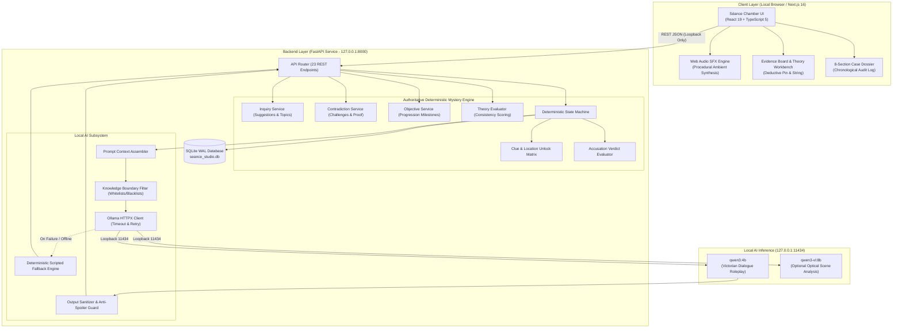

<<<<<<< HEAD
# S-ance-Studio
=======
# Séance Studio: Interactive AI Ghost Stories 🕯️

[](https://opensource.org/licenses/MIT)
[](https://www.python.org/)
[](https://fastapi.tiangolo.com/)
[](https://nextjs.org/)
[](https://www.typescriptlang.org/)
[](https://ollama.com/)
[](docs/TESTING.md)
[](docs/CONTRIBUTING.md)

> **"When the clock chimed an impossible thirteenth strike at midnight, Lady Eleanor died in her locked study. Convene with the living and the dead to uncover the truth before the ward candle burns down."**

**Séance Studio** is an offline-first, local-first supernatural detective inquest set in the storm-wracked Welsh cliffs of **Blackwood Manor (October 1922)**. Players step across the threshold as a court-appointed occult inquisitor to interrogate living suspects and commune with spirits via local LLM roleplay, explore haunted Victorian chambers, challenge testimony contradictions against physical evidence, link forensic relics on a corkboard, formulate testable theories, and deliver a formal accusation matrix determining the fate of the estate.

---

## 📑 Table of Contents

1. [Why Séance Studio? (Core Philosophy)](#-why-s%C3%A9ance-studio-core-philosophy)
2. [Game Overview & Narrative Premise](#-game-overview--narrative-premise)
3. [Gameplay Systems & Feature Walkthrough](#-gameplay-systems--feature-walkthrough)
   - [Mansion Grounds Exploration](#1-mansion-grounds-exploration)
   - [Séance Chamber & 6-Mode Inquiry System](#2-s%C3%A9ance-chamber--6-mode-inquiry-system)
   - [Interactive Evidence Board & Theory Workbench](#3-interactive-evidence-board--theory-workbench)
   - [Comprehensive 8-Section Case Dossier](#4-comprehensive-8-section-case-dossier)
   - [Dynamic Objective Tracker](#5-dynamic-objective-tracker)
   - [Formal Accusation Protocol & Endings](#6-formal-accusation-protocol--endings)
4. [UI/UX Design System & Frontend Experience](#-uiux-design-system--frontend-experience)
   - [Gothic Victorian Visual Identity & Color Palette](#gothic-victorian-visual-identity--color-palette)
   - [Typography & Hierarchical Contrast](#typography--hierarchical-contrast)
   - [Interface Layouts & Component Hierarchy](#interface-layouts--component-hierarchy)
   - [Procedural Web Audio Soundscape](#procedural-web-audio-soundscape-zero-audio-files)
   - [Interactive Micro-Interactions & Sensory Feedback](#interactive-micro-interactions--sensory-feedback)
   - [Resilient Error & Recovery UX](#resilient-error--recovery-ux)
5. [Technical Architecture & How It Works](#-technical-architecture--how-it-works)
   - [Architecture Diagram](#high-level-architecture)
   - [Deterministic Mystery Engine Authority](#deterministic-mystery-engine-authority)
   - [Local AI & Character Knowledge Boundaries](#local-ai--character-knowledge-boundaries)
   - [Offline-First & Security Guardrails](#offline-first--security-guardrails)
6. [Complete REST API Reference (23 Endpoints)](#-complete-rest-api-reference-23-endpoints)
7. [Windows Launch & Developer Setup Guide](#-windows-launch--developer-setup-guide)
8. [Testing & Quality Assurance](#-testing--quality-assurance)
9. [Tech Stack](#-tech-stack)
10. [License & Attribution](#-license--attribution)

---

## 🌟 Why Séance Studio? (Core Philosophy)

Most AI-assisted video games rely on expensive, centralized cloud APIs that introduce network latency, transmit player data, compromise privacy, and risk complete application failure during cloud outages.

**Séance Studio is built on a radically different local-first architecture:**

- 🔒 **100% Data Sovereignty & Offline Autonomy**: All prompt synthesis, reasoning, state evaluation, and audio processing occur entirely on your local machine (`127.0.0.1`). Zero telemetry, zero analytics, zero external network requests.
- ⚡ **Zero Cloud Fees or Token Quotas**: Powered by the open-weight **`qwen3:4b`** model running in local Ollama. Interrogate suspects and test hypotheses endlessly without API bills or rate limits.
- 🛡️ **Authoritative Deterministic Mystery Engine**: While the local LLM generates immersive, in-character Victorian dialogue, **authoritative Python code** has sole control over clue discovery, location unlocks, trust modifiers, contradictions, and case endings. The AI cannot hallucinate game items or prematurely spoil the murderer.
- 🧩 **Anti-Spoiler Knowledge Silos**: Each character’s AI context is dynamically filtered through strict whitelists and blacklists. Suspects only know what they physically witnessed or what the player has proven to them.
- 🕯️ **Sensory Victorian Atmosphere**: Built-in Web Audio API procedural sound synthesizer generates dynamic rainstorms, distant thunder, grandfather clock tolls, planchette scratches, and spectral chimes on the client without external audio assets.

---

## 📜 Game Overview & Narrative Premise

On the storm-swept night of **October 14, 1922**, matriarch **Lady Eleanor Blackwood** was found lifeless on the velvet carpet of her locked library. Beside her right hand lay an empty silver monogrammed cordial flask. At midnight, the manor's astronomical grandfather clock did not cease at twelve strikes: an impossible, hollow **thirteenth chime** echoed through the timbers, jamming the clockwork dead at **12:13 AM**.

As Madame Vane ignites the protective circle of ward candles in the Séance Parlor, you take charge of the inquest. With every inquiry, the protective **Ward Candle melts by 2.5%** and the detective's **Sanity score strains**. Solve the crime before the flame drowns in wax:

- **The Victim**: Lady Eleanor Blackwood — Shipping heiress and private collector of occult artifacts.
- **The True Culprit**: Lord Julian Blackwood — Eleanor's dissolute nephew, drowning in £8,500 Mayfair gambling debts.
- **The Weapon**: Arsenic trioxide administered in Eleanor's 11:30 PM valerian cordial.
- **The Cover-Up**: Julian filed the brass escapement gear of the astronomical clock with a jeweler's rasp to trigger 13 strikes at midnight, muffling Eleanor's gasps and confusing the coroner's time of death.
- **The Decisive Proof**: Julian's handwritten Poison Ledger & Forged Codicil stashed in the crypt behind barrel rack 12.

---

## 🎮 Gameplay Systems & Feature Walkthrough

### 1. Mansion Grounds Exploration
The manor features 5 Victorian chambers connected in an exploration graph:
- **The Grand Foyer (`room_foyer`)**: The grand entrance where Caretaker Arthur Briggs stands guard beside the grand staircase.
- **The Séance Parlor (`room_seance`)**: Velvet-draped communion room illuminated by wax tapers and the spirit board.
- **The Locked Library (`room_library`)**: The sealed crime scene. Unlocks once Caretaker Arthur Briggs' trust reaches 40% and initial inquiries are completed.
- **The Iron Conservatory (`room_conservatory`)**: Overgrown glasshouse where Arthur's potting bench resides. Unlocks when Arthur's trust is boosted to 50% by confronting him with the clockwork escapement.
- **The Wine Cellar & Family Crypt (`room_cellar`)**: Underground crypt containing vintage port casks and the Blackwood family vaults. Unlocks when Victoria Blackwood yields the brass crypt key after being confronted with the torn crimson velvet shred.

Each room includes inspectable points of interest (hotspots) that trigger forensic examinations, narrative choices, and clue discoveries.

---

### 2. Séance Chamber & 6-Mode Inquiry System

The Séance Chamber ([InterviewPanel.tsx](frontend/src/components/screens/InterviewPanel.tsx)) features an interrogation workbench offering **6 distinct inquiry modes**:

```
[ 💡 Suggested Inquiries ] [ 📜 Investigate Topic ] [ 🔍 Present Evidence ] [ ⚖️ Challenge Contradiction ] [ 🕯️ Conduct Séance ] [ ✍️ Free Inquest ]
```

1. 💡 **Dynamic Suggested Inquiries (`suggested_questions`)**:
   - Generates **5–8 dynamic, contextual questions** for the active character.
   - Includes topic filter pills: `All`, `Death`, `13th Chime`, `Clockwork`, `Poison`, `Will`, `Alibis`, `Feuds`, `Occult`.
   - Questions unlock dynamically as the player discovers clues, raises suspect trust, and triggers narrative flags.
2. 📜 **Investigate Topic (`investigate_topic`)**:
   - Structured investigation across the **10 canonical scenario topics**:
     `death`, `thirteenth_chime`, `clock`, `poison`, `will`, `alibis`, `relationships`, `physical_evidence`, `contradictions`, `supernatural_events`.
   - Displays known forensic facts, associated discovered clues, unlocked questions, and unresolved leads.
3. 🔍 **Present Evidence (`present_evidence`)**:
   - Interactive card deck of all discovered forensic exhibits (`clue_silver_flask`, `clue_thirteenth_chime`, `clue_burned_will`, `clue_arsenic_vial`, `clue_torn_velvet`, `clue_crypt_journal`).
   - Inspect forensic markings in detail, then present directly to a suspect to elicit behavioral breakdowns and secret disclosures.
4. ⚖️ **Challenge Contradiction (`challenge_contradiction`)**:
   - Highlights discrepancies between witness statements and physical evidence.
   - **5 Authoritative Contradictions**:
     - *Clock Tampering vs Spontaneous Breakdown* (Arthur Briggs)
     - *Charred Codicil vs Harmonious Relations* (Victoria Blackwood)
     - *Apothecary Vial Theft vs Accidental Poisoning* (Arthur Briggs)
     - *Crimson Velvet Window Catch vs Sealed Locked Room* (Victoria Blackwood)
     - *11:30 PM Cordial vs Instantaneous Death* (Eleanor's Apparition)
   - Challenging with proof shatters witness alibis, awards **+15 to +25 Trust**, and unlocks confessions. Premature challenges without proof are dismissed with a **-10 Trust penalty**.
5. 🕯️ **Conduct Séance (`conduct_seance`)**:
   - Dedicated spiritualist communion mode when active character is a spirit or medium.
   - Channel astral memories of the murder moment, pose spectral queries, and observe ectoplasmic anomalies.
6. ✍️ **Free Inquest (`free_question`)**:
   - Unconstrained natural-language input field available in all active chamber states.
   - Real-time character response synthesis powered by local Ollama (`qwen3:4b`), strictly guarded by knowledge whitelists.

---

### 3. Interactive Evidence Board & Theory Workbench

The Evidence Board ([EvidenceBoard.tsx](frontend/src/components/screens/EvidenceBoard.tsx)) provides a deductive corkboard interface:

- **Category Filters**: Filter exhibits by `Physical`, `Document`, `Paranormal`, and `Testimony`.
- **Crimson Yarn Linkages**: Select any two exhibits to test a causal deduction. If the relationship matches permitted engine rules, a persistent crimson string is pinned to the corkboard.
- **Theory Formulation & Consistency Workbench**:
  - Select an **Accused Suspect**, **Murder Instrument**, **Motive Evidence**, and **Supporting Exhibits**.
  - Click **"Test Hypothesis Consistency"** to submit the theory to `/api/v1/investigations/{session_id}/theory/evaluate`.
  - The engine returns an authoritative **Consistency Score (0–100%)**, **Corroborated Strengths**, **Fatal Contradictions**, and **Verdict Readiness Guidance** (e.g., *"Ready for Inquest Verdict: S-Rank Solvability Established"* or *"Flawed Hypothesis: Contradicted by known alibis"*).

---

### 4. Comprehensive 8-Section Case Dossier

The Case Dossier ([JournalView.tsx](frontend/src/components/screens/JournalView.tsx)) maintains an audit trail across 8 structured sections:

1. **Overview**: Case metadata, victim bio, time of death, current act, and ward candle / sanity levels.
2. **Timeline**: 9:00 PM to 12:15 AM chronological reconstruction of the murder night.
3. **Witness Statements**: Character dossiers, current trust scores, temperaments, and recorded testimony.
4. **Discovered Evidence**: Complete inventory of discovered forensic exhibits and source locations.
5. **Contradictions**: Reconciled witness claims versus physical facts.
6. **Unanswered Leads**: Active investigative leads and puzzle hints.
7. **Current Theories**: Working hypotheses and custom detective notes.
8. **Inquest History**: Chronological audit log of all validated player choices and decisions.

---

### 5. Dynamic Objective Tracker

The game tracks progress through **7 sequential progression milestones**:
1. *Convene the Inquest*: Interview Arthur Briggs and Lady Eleanor's spirit.
2. *Examine the Crime Scene*: Unlock and search the Locked Library.
3. *Uncover Horological Tampering*: Discover the filed escapement teeth in the clock.
4. *Trace the Poison Source*: Identify the stolen arsenic vial in the Conservatory.
5. *Expose Financial Motive*: Recover the burned codicil from the library grate.
6. *Infiltrate the Family Crypt*: Confront Victoria to secure the crypt key and locate the poison ledger.
7. *Deliver Final Inquest Verdict*: Assemble the household and deliver the formal indictment.

---

### 6. Formal Accusation Protocol & Endings

Once sufficient evidence is assembled, the detective commits their formal accusation through the Evidence Board:

| Ending ID | Verdict Classification | Inquest Rating | Criteria to Achieve | Narrative Outcome |
| :--- | :--- | :--- | :--- | :--- |
| **`END_TRUE_RESTITUTION`** | Exemplary Victory | **Rank S (Master Occult Detective)** | Accuse Lord Julian + Silver Flask + Burned Will + Clock Escapement + Arsenic Vial + Crypt Journal + Sanity ≥ 40 + Caretaker Trust ≥ 50 + Daughter Trust ≥ 55 | Julian breaks down and confesses; Scotland Yard makes the arrest; Victoria inherits the estate; Eleanor's spirit dissolves peacefully into dawn mist. |
| **`END_TRAGIC_COVERUP`** | Hollow Victory | **Rank C (Inconclusive Inquest)** | Accuse Lord Julian + Silver Flask + Burned Will, but lacking Crypt Journal or testimony | Crown magistrate rules evidence circumstantial; Julian escapes on morning steamer with the family fortune; manor falls into ruin. |
| **`END_SPECTRAL_WRATH`** | Wrongful Conviction | **Rank F (Tragic Miscarriage)** | Accuse innocent suspect (Arthur or Victoria) | The spirit world is enraged; the ward candle explodes in black flame; a violent poltergeist storm claims the souls of all inside. |
| **`END_VESSEL_OF_THE_DAMNED`** | Insanity Collapse | **Defeat** | Sanity reaches 0 | Detective's mind shatters; becomes an unquiet vessel wandering the corridors. |
| **`END_THE_COLD_DARK`** | Ward Extinguishment | **Defeat** | Ward Candle reaches 0.0% | Protective circle expires; shadows extinguish all mortal light. |

---

## 🎨 UI/UX Design System & Frontend Experience

Séance Studio combines authentic Victorian-Gothic period aesthetics with modern web application ergonomics. The interface is engineered to evoke the atmosphere of an October 1922 occult parlor—illuminated solely by guttering wax tapers, rattling leaded glass, and lightning flashes—while providing clean, intuitive detective tooling.

```
+---------------------------------------------------------------------------------------------------+
|  APP SHELL HUD: [Turn 6/30]  [🕯️ Ward Candle: 85.0%]  [🧠 Sanity: 92%]  [⚡ Tension: 24%]  [● Ready]  |
+---------------------------------------------------------------------------------------------------+
|  NAVIGATION: [ 🏰 Manor Map ] [ 🕯️ Séance Chamber ] [ 📌 Evidence Board ] [ 📖 Case Dossier ]   |
+---------------------------------------------------------------------------------------------------+
|  ACTIVE SCREEN WORKBENCH                                                                          |
|  - Séance Chamber: Suspect Carousel -> Trust Gauge -> 6-Mode Switcher -> EVP Feed -> Inquest Form|
|  - Evidence Board: Corkboard Categories -> Crimson String Weaving -> Theory Consistency Evaluator |
|  - Case Dossier: 8-Section Archival Tabbed Ledger with Inline Forensic Observation Inscriber     |
+---------------------------------------------------------------------------------------------------+
|  PROCEDURAL AUDIO SYNTHESIZER: Rain Generator • Thunder Sub-Bass • 13th Chime Bells (Web Audio)   |
+---------------------------------------------------------------------------------------------------+
```

---

### Gothic Victorian Visual Identity & Color Palette

The visual design rejects generic flat themes in favor of an authentic period palette that maximizes contrast, reduces eye strain during night sessions, and establishes psychological immersion:

| Color Token | Hex Code | Visual Swatch & Theme Role | Atmospheric Meaning & Emotional Impact |
| :--- | :--- | :--- | :--- |
| **Obsidian Shadow** | `#0a080a`, `#120f12`, `#161214` | Deep Charcoal & Cold Stone | The oppressive dark halls of Blackwood Manor; grounds the interface in Victorian gloom. |
| **Horological Brass** | `#c5a059`, `#dfc282`, `#88652c` | Antique Gold & Toned Brass | Clockwork gears, filigree borders, active UI states, key evidence, and candlelight highlights. |
| **Aged Parchment** | `#ece3cd`, `#d4c8af`, `#b8a88a` | Warm Paper & Faded Ink | Historical wills, coroner autopsy notes, witness dialogue transcripts, and legible body copy. |
| **Forensic Crimson** | `#8a1f29`, `#fca5a5`, `#2d1115` | Velvet Drapes & Dried Blood | Critical contradictions, fatal theory flaws, accusation actions, and high-tension warnings. |
| **Spectral Ectoplasm**| `#7dd3fc`, `#38bdf8`, `#c084fc` | Cyan Mist & Violet Flame | Spirit conduit presence, EVP recording streams, astral communion chants, and the ward candle. |

---

### Typography & Hierarchical Contrast

The typographic system pairs period broadsheet dignity with forensic precision:

1. **Display & Headings (`font-serif`)**: High-contrast, elegant Victorian serif typography with uppercase tracking (`tracking-wide`, `tracking-wider`). Evokes 1920s court inquest broadsheets, occult treatises, and engraved parlor signage.
2. **Forensic Telemetry & Technical Markers (`font-mono`)**: Clean monospace typography (`ui-monospace`, `Courier New`) for timestamps (`12:13 AM`), exhibit identifiers (`[EXHIBIT A-1]`), coordinates, turn counts, and mathematical metrics.
3. **Dialogue & Field Notes (`font-serif`, `leading-relaxed`)**: Generous line spacing and warm parchment tones resembling published Victorian mystery novellas, ensuring extended dialogue reading remains effortless.

---

### Interface Layouts & Component Hierarchy

The frontend is organized into 5 primary specialized inquiry screens wrapped by a persistent HUD:

#### 1. Persistent AppShell HUD ([AppShell.tsx](frontend/src/components/game/AppShell.tsx))
- **Inquest Status Meters**:
  - **Ward Candle Gauge**: Animated melting percentage bar with flickering flame icon (`100.0% -> 0.0%`).
  - **Player Sanity Bar**: Heart indicator tracking psychological resilience; turns crimson as insanity nears.
  - **Ectoplasmic Tension Meter**: Gauge measuring supernatural room disturbance.
  - **Inquest Turn Tracker**: Compact badge showing current turn and act (`Turn 6 of 30 • Act 1`).
- **Local AI Diagnostic Pill**: Live indicator verifying Ollama daemon status and active model (`qwen3:4b`).
- **Procedural Soundscape Toggle**: One-click mute/unmute control for ambient rain and atmospheric audio.

#### 2. Mansion Grounds Floor Plan ([MansionDashboard.tsx](frontend/src/components/screens/MansionDashboard.tsx))
- **Chamber Status Badges**: Each wing card displays its status: `SEALED` (with padlock icon), `SPIRIT` (with glowing cyan ghost pulse), or `CLEAR`.
- **Occupant Presence Indicators**: Tags showing which suspects currently occupy each room.
- **Inspectable Hotspots**: Interactive POIs (e.g., grandfather clock face, potting bench, barrel rack 12) for forensic discovery.
- **Unresolved Leads Drawer**: Instant access to remaining leads and clues for the active wing.

#### 3. Séance Chamber & Interrogation ([InterviewPanel.tsx](frontend/src/components/screens/InterviewPanel.tsx))
- **Suspect Carousel**: Character portrait selector with antique gold highlight rings and status badges (`Living`, `Spirit`, `Medium`).
- **Dynamic Trust Meter**: Gradient bar (`#88652c` -> `#dfc282`) displaying numeric trust (0–100%) and descriptive psychological demeanor (`Receptive`, `Guarded`, `Defensive`, `Hostile`).
- **6-Mode Inquiry Workbench**: Instant tabbed switching between Suggested Inquiries, Topic Investigation, Presenting Evidence, Contradiction Challenges, Spectral Séance, and Free Natural-Language Inquests.
- **EVP Dialogue Feed**: Scrollable transcription feed distinguishing Investigator utterances (antique gold badges) from Character responses (parchment speech bubbles with emotional demeanor cues).
- **Permanent Bottom Prompt**: The Inscribe Question input and Inquire button remain permanently accessible across all modes so player agency is never restricted.

#### 4. Deductive Evidence Board ([EvidenceBoard.tsx](frontend/src/components/screens/EvidenceBoard.tsx))
- **Corkboard Category Tabs**: Instant filtering by `All`, `Physical`, `Document`, and `Paranormal`.
- **Crimson Yarn Weaving Simulator**: Select two exhibits to test a causal deduction. If validated by engine rules, a persistent crimson string is pinned to the corkboard.
- **Theory Formulation Workbench**: Construct hypotheses (Accused Suspect + Murder Instrument + Motive Evidence + Supporting Exhibits) and test consistency against the authoritative engine.

#### 5. Case Dossier & Field Ledger ([JournalView.tsx](frontend/src/components/screens/JournalView.tsx))
- **8-Section Archival Tabbed Dossier**: Jump between Overview, Timeline, Witnesses, Discovered Evidence, Contradictions, Unanswered Leads, Current Theories, and Inquest History.
- **Inline Observation Composer**: Dedicated modal allowing detectives to inscribe custom forensic facts or hypotheses directly into the case ledger.

---

### Procedural Web Audio Soundscape (Zero Audio Files)

Séance Studio features a **100% client-side Web Audio API sound synthesizer** ([audio.ts](frontend/src/lib/audio.ts)) that generates all atmospheric sound effects programmatically through code:

- 🌧️ **Ambient Rain Generator**: White noise buffer passed through biquad bandpass filters with dynamic frequency modulation, simulating variable rain thrashing against leaded glass.
- ⚡ **Distant Storm Thunder**: Low-frequency sub-bass oscillator with exponential gain decay and low-pass filter sweeps.
- 🔔 **The Thirteenth Chime**: Dual metallic FM bell synthesizers with inharmonic overtones, tuned to 220 Hz and 330 Hz with a 13-second natural resonance tail.
- 📜 **Planchette Board Friction**: Pink noise bursts simulating wood sliding across textured paper during spiritualist communion.
- 🖋️ **Tactile Feedback**: Subtle paper rustles, mechanical clock ticks, and typewriter key clicks on button interactions.
- 🚀 **Zero Bandwidth Overhead**: Because all audio is synthesized directly by the browser's audio hardware, the application requires **zero MP3 or WAV downloads**, ensuring instantaneous zero-latency playback even when offline.

---

### Interactive Micro-Interactions & Sensory Feedback

- **Ethereal Planchette Loading State**: During local LLM inference, an animated, pulsing planchette banner (`✦ The Planchette Slides Across the Spirit Board... ✦`) displays the active endpoint (`127.0.0.1:11434`) and prevents accidental double-submissions while keeping the player immersed in the séance lore.
- **Contextual Toast Notification Center**: Non-blocking floating notifications slide in from the screen corner to acknowledge clue discoveries, sanity fluctuations, trust adjustments, and milestone completions.
- **Interactive Exhibit Modals**: Clicking any evidence card opens a high-detail forensic lightbox showcasing the relic's visual artwork, forensic markers, and significance.

---

### Resilient Error & Recovery UX

When local system load or service interruptions occur, the UI never crashes or shows cryptic JSON dumps. Instead, it displays a **Gothic Actionable Error Card** that categorizes the exact failure and provides 1-click remedies:

```
+-----------------------------------------------------------------------------------------------+
|  ⚠ PARANORMAL CHANNEL INTERRUPTION [Engine Disturbance]                                       |
|  An unexpected communication fault prevented the spirit's voice from coalescing.              |
|  ✦ Required Action: Review your field notes or re-submit inquiry to re-establish psychic link.|
|                                                                                               |
|  [ View Case Ending ]   [ Begin New Investigation ]   [ Case Archives ]   [ 🔄 Retry Inquest ] |
+-----------------------------------------------------------------------------------------------+
```

- **Session Completed**: Replaces input with a conclusion banner and offers one-click buttons to *"View Case Ending"* or *"Open Archives"*.
- **Ollama Offline**: Informs the user that `127.0.0.1:11434` is unreachable and prompts them to start Ollama with one-click retry.
- **Model Missing**: Explains that `qwen3:4b` is not installed, gives the exact terminal command (`ollama pull qwen3:4b`), and enables deterministic fallback dialogue.
- **Inference Timeout**: Explains local system computational load and provides a safe, non-duplicating *"Retry Inquest"* button.

---

## 🏛️ Technical Architecture & How It Works

### High-Level Architecture



### Deterministic Mystery Engine Authority

A critical architectural invariant in Séance Studio:

$$\text{Authoritative Game State} \not\subset \text{LLM Output}$$

1. **State Machine Exclusivity**: The LLM never writes to the SQLite database, advances turns, discovers clues, unlocks rooms, or declares victory.
2. **Deterministic Validation**: Every player action is evaluated by Python functions in `game_state_service.py`, `inquiry_service.py`, and `contradiction_service.py`.
3. **Rollback Safety**: Database mutations use transactional savepoints. If an inquiry or model call fails, all state changes roll back cleanly.

### Local AI & Character Knowledge Boundaries

When a player poses a question, `game_state_service.py` constructs a safe prompt context:
- **Always-Known Facts**: Whitelisted background information the character experienced.
- **Conditional Facts**: Secrets revealed only if specific clue IDs are in `session.discovered_clues`.
- **Strictly Forbidden Knowledge**: Explicit negative constraints forbidding spoilers (e.g., Arthur Briggs is forbidden from knowing the clauses of Eleanor's revised will).
- **Fallback Resilience**: If Ollama is offline or uninstalled, the application automatically falls back to curated deterministic character dialogue without crashing or corrupting game state.

### Offline-First & Security Guardrails

- **Loopback-Only Binding**: Backend listens exclusively on `127.0.0.1:8000`; Ollama listens on `127.0.0.1:11434`.
- **CORS Lockdown**: Only requests from `http://localhost:3000` and `http://127.0.0.1:3000` are permitted.
- **No Cloud Egress**: Zero external API endpoints, zero analytics, zero external font or script CDN tags.
- **Defense-in-Depth Exception Handling**: Sanitized error responses prevent leaking server directory paths or stack traces.

---

## 🔌 Complete REST API Reference (23 Endpoints)

Interactive Swagger documentation is available at **`http://127.0.0.1:8000/docs`**.

### 1. System Health & Diagnostics
| Method | Endpoint | Description |
| :--- | :--- | :--- |
| `GET` | `/api/v1/health` | Comprehensive health probe (Database, Ollama, Models, Air-Gap status). |
| `GET` | `/api/v1/ai/status` | Detailed metrics and latency checks for local Ollama. |
| `POST` | `/api/v1/ai/visual-evidence` | Optional visual evidence analysis via `qwen3-vl:8b`. |

### 2. Investigation Sessions
| Method | Endpoint | Description |
| :--- | :--- | :--- |
| `GET` | `/api/v1/investigations` | Lists all saved investigation sessions for resuming. |
| `POST` | `/api/v1/investigations` | Consecrates a new investigation session with initial entities. |
| `GET` | `/api/v1/investigations/{id}` | Retrieves complete session detail, characters, clues, and journal. |
| `POST` | `/api/v1/investigations/{id}/recover` | Recovers completed sessions back to active state. |
| `POST` | `/api/v1/investigations/{id}/resume` | Ensures session is active and updates timestamps. |
| `POST` | `/api/v1/investigations/{id}/accuse` | Submits formal accusation deduction matrix for verdict. |

### 3. Dialogue & Interrogation
| Method | Endpoint | Description |
| :--- | :--- | :--- |
| `GET` | `/api/v1/investigations/{id}/messages` | Fetches complete conversation transcript history. |
| `POST` | `/api/v1/investigations/{id}/messages` | Sends natural-language query to active character via local LLM. |
| `POST` | `/api/v1/investigations/{id}/actions` | Executes state-changing game actions (`TALK`, `INSPECT`, `RITUAL`, `ACCUSE`). |

### 4. Dynamic Inquiries, Topics & Contradictions (Expanded System)
| Method | Endpoint | Description |
| :--- | :--- | :--- |
| `GET` | `/api/v1/investigations/{id}/suggestions` | Generates 5–8 dynamic suggested questions with topic filters. |
| `GET` | `/api/v1/investigations/{id}/topics` | Retrieves the 10 canonical topics with unlocked state and leads. |
| `GET` | `/api/v1/investigations/{id}/contradictions` | Lists testimony contradictions and evidence conflict points. |
| `POST` | `/api/v1/investigations/{id}/contradictions/challenge` | Confronts suspect with contradiction; awards trust or applies penalty. |
| `GET` | `/api/v1/investigations/{id}/objectives` | Tracks 7-step progression milestones and active status. |
| `POST` | `/api/v1/investigations/{id}/theory/evaluate` | Evaluates theory consistency (0–100%), strengths, and flaws. |

### 5. Evidence Board & Clues
| Method | Endpoint | Description |
| :--- | :--- | :--- |
| `GET` | `/api/v1/investigations/{id}/evidence` | Retrieves discovered clues and valid board string linkages. |
| `POST` | `/api/v1/investigations/{id}/evidence/connect` | Validates and connects two clues with crimson yarn. |
| `POST` | `/api/v1/investigations/{id}/evidence/disconnect` | Severs an existing string connection. |
| `POST` | `/api/v1/investigations/{id}/discoveries` | Discovers a clue through hotspot inspection or confrontation. |

### 6. Case Journal Ledger
| Method | Endpoint | Description |
| :--- | :--- | :--- |
| `GET` | `/api/v1/investigations/{id}/journal` | Retrieves chronological coroner facts and notes. |
| `POST` | `/api/v1/investigations/{id}/journal` | Inscribes a custom detective fact or theory into the dossier. |

---

## 🚀 Windows Launch & Developer Setup Guide

### Prerequisites
1. **Python 3.10+**: [python.org](https://www.python.org/)
2. **Node.js 18+**: [nodejs.org](https://nodejs.org/)
3. **Ollama**: [ollama.com](https://ollama.com/) (running in taskbar tray on `http://127.0.0.1:11434`)

### Step 1: Obtain the Local Model
Open PowerShell and verify or download the recommended dialogue model:
```powershell
ollama pull qwen3:4b
```
*(Optional vision model for visual evidence inspection: `ollama pull qwen3-vl:8b`)*

### Step 2: Install Dependencies
```powershell
# 1. Install Backend Dependencies
pip install -r backend/requirements.txt

# 2. Install Frontend Dependencies
npm --prefix frontend install
```

### Step 3: Launch Séance Studio

#### Option A: 1-Click Launch (Recommended)
Double-click **`start.bat`** in the repository root, or run in PowerShell:
```powershell
powershell -ExecutionPolicy Bypass -File .\scripts\launch.ps1
```
The script verifies prerequisites, checks model availability, applies database migrations, starts backend and frontend servers, and opens `http://localhost:3000`.

#### Option B: Manual Two-Terminal Launch (Development)

**Terminal 1 — Backend (FastAPI on Port 8000):**
```powershell
python -m uvicorn app.main:app --app-dir backend --host 127.0.0.1 --port 8000 --reload --reload-dir backend
```
*Health Probe:* [http://127.0.0.1:8000/api/v1/health](http://127.0.0.1:8000/api/v1/health)  
*Swagger Docs:* [http://127.0.0.1:8000/docs](http://127.0.0.1:8000/docs)

**Terminal 2 — Frontend (Next.js on Port 3000):**
```powershell
npm run dev
# Or: npm --prefix frontend run dev
```
*Game UI:* [http://localhost:3000](http://localhost:3000)

### Graceful Shutdown
To cleanly terminate running servers:
```powershell
powershell -ExecutionPolicy Bypass -File .\scripts\stop.ps1
```

---

## 🧪 Testing & Quality Assurance

Séance Studio features a comprehensive automated test suite with **131 total passing tests** (100% pass rate):

```powershell
# 1. Run All Backend Tests (103 tests across 13 modules)
python -m pytest backend/tests

# 2. Run All Frontend Tests (28 unit tests via Node test runner)
npm --prefix frontend test

# 3. Verify TypeScript Compilation & Type Safety
npx --prefix frontend tsc -p frontend/tsconfig.json --noEmit

# 4. Run Full-Stack Automated Verification Script
python scratch/verify_e2e_lifecycle.py
```

### Test Coverage Highlights
- **State Machine Integrity**: Clue discovery idempotency, location lock progression, turn limit enforcement, sanity decay.
- **AI Resilience**: Missing Ollama service, model not installed, inference timeout, deterministic fallback validation.
- **Anti-Spoiler Guardrails**: Whitelisted facts isolation, forbidden knowledge containment.
- **Inquiry & Contradictions**: Suggested inquiries generation, topic filters, contradiction challenges, theory consistency scoring.
- **Security & Offline Audit**: Loopback interface validation, path traversal prevention, CORS restrictions.

---

## 💻 Tech Stack

- **Backend**: Python 3.14, FastAPI 0.162, SQLAlchemy 2.1 ORM, Pydantic v2, Uvicorn, SQLite WAL.
- **Frontend**: Next.js 16 (App Router + Turbopack), React 19, TypeScript 5.9, Tailwind CSS v4, Lucide React.
- **AI & Inference**: Ollama Local Runtime, `qwen3:4b` (Primary Dialogue Roleplay), `qwen3-vl:8b` (Optional Vision Analysis).
- **Audio Engine**: Client-side Web Audio API procedural sound engine (zero audio files required).
- **Testing**: Pytest, Pytest-Asyncio, Starlette TestClient, Node.js Native Test Runner.

---

## 📜 License & Attribution

- **Codebase**: Licensed under the [MIT License](LICENSE).
- **Story Lore & Visual Assets**: Blackwood Manor narrative, scenario content, and local environment artwork are licensed under [CC BY-NC 4.0](https://creativecommons.org/licenses/by-nc/4.0/).
- **AI Model Weights**: Qwen model weights are developed by Alibaba Cloud under the Apache 2.0 / Qwen Research License. Model weights are not bundled in this repository.
>>>>>>> a5be8e4 (Update Seance Studio)
