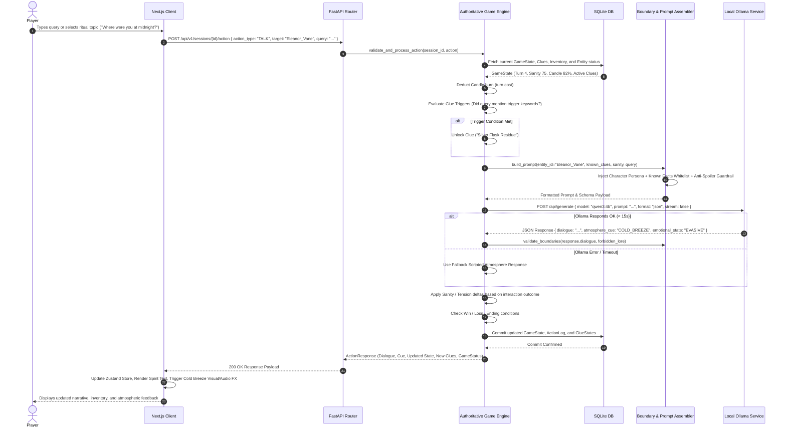
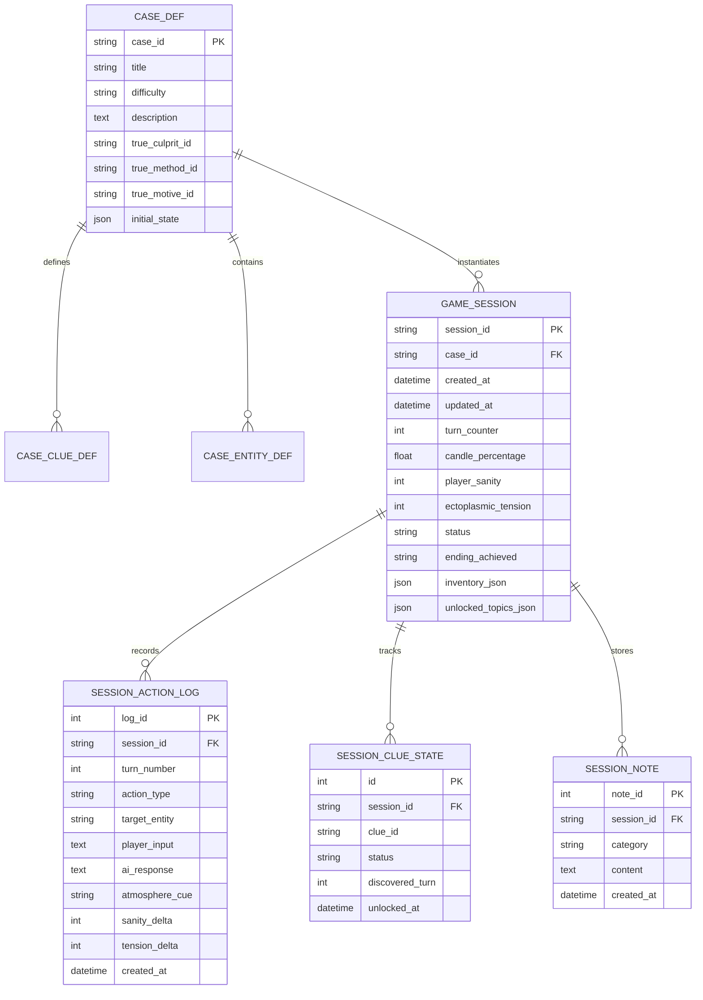

# Séance Studio — System Architecture Specification
**Document Version:** 1.0.0  
**Target Platform:** Windows 10/11 Local Offline Workstation  
**Classification:** Authoritative Technical Architecture

---

## 1. Executive Summary & Offline-First Principles

*Séance Studio* is an offline-first interactive horror mystery game set in a Victorian-Gothic paranormal recording chamber. Players assume the role of an occult investigator conducting spiritualist séances to uncover the truth behind tragic deaths, haunted heirlooms, and cryptic conspiracies.

### Core Architectural Principles
1. **Absolute Offline Autonomy**: The system requires zero internet access during gameplay. No cloud inference, external telemetry, third-party analytics, remote CDNs, or external asset loading are permitted.
2. **Authoritative Deterministic Game Engine**: The generative AI (Ollama) is strictly a *roleplay dialogue and atmosphere synthesizer*. It has **zero authority** over game state transitions, clue unlocks, tension counters, inventory changes, or victory/defeat conditions. The backend Python Game Engine is the sole authoritative state machine.
3. **Strict Character Knowledge Boundaries**: Spirits and witnesses possess immutable knowledge silos. AI prompts are dynamically assembled with strict boundary guardrails, preventing the LLM from hallucinating undiscovered plot points or leaking game-ending revelations prematurely.
4. **No Unsolicited Network Operations**: The system never downloads models, switches model weights silently, or triggers external network requests. If Ollama or the configured model is unavailable, the backend returns clear diagnostic errors and can operate in deterministic fallback mode.
5. **Windows-Native Local Ergonomics**: Built specifically for Windows workstations with standard local paths, single-port service orchestration, and predictable hardware resource allocation.

---

## 2. High-Level System Architecture

The following diagram illustrates the relationship between the client, backend, game engine, local database, and local Ollama instance:

```mermaid
graph TB
    subgraph Client ["Client Layer (Local Browser / Next.js)"]
        UI[Séance Chamber UI<br/>Next.js App Router + Tailwind]
        AudioFX[Web Audio / Ambient SFX Engine]
        Store[Zustand / React Context State Store]
        ApiClient[Local REST Client (Fetch API)]
        UI --> Store
        Store --> ApiClient
        Store --> AudioFX
    end

    subgraph Backend ["Backend Layer (FastAPI Service - 127.0.0.1:8000)"]
        Router[FastAPI API Router]
        Middleware[CORS, Error Handling & Logging Middleware]
        SessionMgr[Session & Case Manager]
        
        subgraph Engine ["Authoritative Game Engine"]
            FSM[Deterministic State Machine]
            RulesEngine[Rules & Turn Processor]
            SanityMgr[Tension & Sanity Controller]
            ClueResolver[Clue & Knowledge Resolver]
        end
        
        subgraph AIIntegration ["AI Subsystem"]
            PromptAssembler[Prompt & Context Assembler]
            BoundaryGuard[Knowledge Boundary Filter]
            OllamaClient[Local Ollama API Client (httpx)]
            OutputValidator[Pydantic Structured Output Validator]
        end

        Router --> Middleware
        Middleware --> SessionMgr
        SessionMgr --> FSM
        FSM --> RulesEngine
        RulesEngine --> SanityMgr
        RulesEngine --> ClueResolver
        RulesEngine --> PromptAssembler
        PromptAssembler --> BoundaryGuard
        BoundaryGuard --> OllamaClient
        OllamaClient --> OutputValidator
        OutputValidator --> RulesEngine
    end

    subgraph Storage ["Persistence Layer (Local Disk)"]
        DB[(SQLite Database<br/>seance_studio.db)]
        ORM[SQLAlchemy 2.0 ORM]
        Migrations[Alembic Migrations]
        RulesEngine --> ORM
        SessionMgr --> ORM
        ORM --> DB
        Migrations --> DB
    end

    subgraph LocalAI ["Local Inference Layer (127.0.0.1:11434)"]
        OllamaDaemon[Ollama Service]
        LocalModel[(Open-Weight Model<br/>e.g., Qwen3-4B / Llama-3.2-3B)]
        OllamaDaemon --> LocalModel
        OllamaClient -.->|HTTP POST /api/generate| OllamaDaemon
    end
```

---

## 3. Component Breakdown

### 3.1. Frontend (Presentation Layer)
- **Framework**: Next.js 14+ (App Router), React 18/19, TypeScript.
- **Styling**: Tailwind CSS configured with a bespoke Gothic/Occult dark theme (deep obsidian `#0a0a0c`, aged parchment `#d8cca3`, dried blood crimson `#7f1d1d`, spirit ether cyan `#38bdf8`, and candle gold `#eab308`).
- **Typography**: Bundled Google Fonts (`Cinzel Decorative`, `Crimson Pro`, `JetBrains Mono`) served entirely locally via `@next/font/local` without external network requests.
- **Atmospheric Visuals**:
  - CRT/Spirit tape-deck audio visualizer using HTML5 Canvas.
  - Interactive Planchette / Spirit Board interface with drag-and-drop or coordinate clicking.
  - Dynamic candlelight flicker and sanity-vignette shader effects using CSS custom properties.
- **Offline Assets**: All SVG icons, ambient sound loops (rain, vinyl crackle, distant thunder, whispers), and texture assets stored under `public/assets/`.

### 3.2. Backend (Application Layer)
- **Framework**: Python 3.11+, FastAPI, Uvicorn.
- **Architecture Pattern**: Clean Layered Architecture (`api` -> `services` -> `engine` -> `models`/`schemas`).
- **Concurrency**: Asynchronous request handling via `asyncio` and `httpx` for Ollama communication, coupled with synchronous SQLite access wrapped safely in threadpools or async SQLAlchemy sessions.
- **Lifecycle Management**: FastAPI lifespan hooks verify database schema integrity and probe Ollama connectivity on startup without blocking server launch if Ollama is dormant.

### 3.3. Authoritative Game Engine (Core Domain)
The Game Engine encapsulates all deterministic rules:
- **Turn Progression**: Each player action (communing, inspecting an artifact, presenting evidence, accusing a suspect) constitutes a turn.
- **Resource Depletion**:
  - **Candle Life (Turns Remaining)**: Candles burn down each turn. Extinguishment triggers the *Dark Void* game ending.
  - **Sanity / Psychic Strain**: Forbidden queries, eerie revelations, and malevolent entity encounters inflict sanity damage. Reaching 0 triggers *Possession* or *Hysteria*.
  - **Ectoplasmic Tension**: Rises with aggressive interrogation or failed rituals, unlocking heightened paranormal manifestations.
- **Clue State Machine**: Clues transition through 3 discrete states: `UNDISCOVERED` -> `HINTED` -> `REVEALED` -> `CONTRADICTED`/`PROVEN`.
- **Accusation & Verdict Matrix**: Player submits a formal Deduction (Suspect + Murder Weapon/Motive + Supernatural Entity). The engine evaluates this against the immutable case truth matrix.

### 3.4. AI Provider & Boundary Guardrails
- **Provider**: Local Ollama HTTP API (`http://127.0.0.1:11434`).
- **Prompt Engineering Strategy**:
  1. **System Persona Prompt**: Defines character voice, era-specific vocabulary (1920s Victorian/Edwardian spiritualism), psychological disposition, and emotional state.
  2. **Knowledge Boundary Block**: Explicit whitelist of facts known to the entity at the current turn.
  3. **Strict Negative Constraints**: Instructions forbidding disclosure of unrevealed facts, modern anachronisms, or meta-references to AI/prompts.
  4. **Structured JSON Output**: The LLM returns a structured JSON payload containing:
     - `dialogue`: The in-character response text.
     - `atmosphere_cue`: Ambient sound effect or visual cue (e.g., `CANDLE_FLICKER`, `COLD_BREEZE`, `TAPE_STATIC`).
     - `emotional_state`: Current stance (e.g., `EVASIVE`, `TERRIFIED`, `ENRAGED`, `SORROWFUL`).
- **Fallback Rule**: If Ollama times out (>15s) or returns malformed text, the engine falls back to pre-authored atmospheric scripted responses ("The spirit board vibrates violently, but the message is lost in static...") to guarantee gameplay is never halted.

### 3.5. Persistence Layer
- **Engine**: SQLite 3 with WAL (Write-Ahead Logging) enabled for fast local reads and concurrent safety.
- **ORM**: SQLAlchemy 2.0 with Declarative Base.
- **Migrations**: Alembic for version-controlled schema evolution.
- **Save State Storage**: Complete game sessions can be saved, exported as JSON, or resumed from SQLite.

---

## 4. End-to-End Data Flow

The sequence diagram below traces an interactive turn when the player queries a spirit through the séance interface:



---

## 5. Authoritative Game-State Specification

### 5.1. Game State Structure
The authoritative state model holds the complete truth of the game session:

```python
class GameSessionState(BaseModel):
    session_id: UUID
    case_id: str                          # e.g., "case_01_blackwood_manor"
    current_act: int                      # Act 1 (Investigation), Act 2 (Séance Confrontation), Act 3 (Accusation)
    turn_counter: int                     # Increments per player action
    max_turns: int                        # Maximum turns before candle expires (e.g., 30)
    candle_percentage: float              # 100.0 down to 0.0
    player_sanity: int                    # 0 to 100 (100 = stable, 0 = broken)
    ectoplasmic_tension: int              # 0 to 100 (escalates supernatural anomalies)
    active_medium: str                    # Active psychic conduit assisting the player
    active_entity: Optional[str]          # Currently summoned spirit
    discovered_clues: List[str]           # List of unlocked Clue IDs
    inventory: List[str]                  # List of physical artifacts in possession
    unlocked_topics: List[str]            # Topics permitted in conversation
    status: GameStatus                    # ACTIVE, VICTORY, DEFEAT_INSANITY, DEFEAT_CANDLE_OUT, DEFEAT_POSSESSION
    ending_achieved: Optional[str]        # Specific ending identifier
```

### 5.2. Sanity and Tension Dynamics
- **Sanity Cost**:
  - Inquiring into violent demise: -5 to -10 Sanity.
  - Confronting a malicious spirit without protective ward: -15 Sanity.
  - Reaching `< 30` Sanity triggers hallucinated dialogue cues in the UI.
  - Reaching `0` Sanity triggers `DEFEAT_INSANITY` (Player becomes unmoored from reality).
- **Tension Triggers**:
  - Blatant contradictions in questioning increase Tension by +10.
  - High tension (`> 70`) causes entity dialogue to become hostile, distorted, or cryptic.
  - High tension triggers supernatural events (e.g., shattered crystal glass, blown-out secondary candles).

### 5.3. Character Knowledge Boundaries
Every character/spirit is bound by a strict knowledge matrix:
1. **Perception Horizon**: A spirit only knows events up to their moment of death. They cannot describe post-mortem events unless communicated by another entity.
2. **Sensory Ambiguity**: Spirits perceive the mortal realm through fractured sensory impressions (smells, sounds, thermal changes), not objective photographic facts.
3. **Hidden Motives & Grievances**: Each entity has a `secret_agenda` (e.g., protecting their surviving spouse, framing a hated sibling).
4. **Boundary Filtering Rule**: The prompt explicitly enumerates:
   - `MUST_KNOW`: Facts the spirit experienced directly.
   - `CAN_SUSPECT`: Rumors or partial inferences the spirit may express with uncertainty.
   - `FORBIDDEN_KNOWLEDGE`: Key case secrets the spirit has no causal link to know. If the LLM generates forbidden tokens, the backend sanitizer masks or replaces them.

### 5.4. Clue Unlock Engine
Clues require deterministic preconditions defined in declarative JSON/Pydantic rules:
```json
{
  "clue_id": "CLUE_ARSENIC_VIAL",
  "name": "Amber Vial of Arsenic",
  "unlock_conditions": {
    "required_topics": ["MEDICINE_CABINET", "SYMPTOMS_BEFORE_DEATH"],
    "required_inventory": ["STUDY_BRASS_KEY"],
    "minimum_turn": 3,
    "max_tension": 80
  },
  "rewards": {
    "clue_type": "PHYSICAL_EVIDENCE",
    "unlocked_topics": ["POISON_PURCHASE"],
    "sanity_delta": -2
  }
}
```

### 5.5. Ending Conditions Matrix
| Ending ID | Type | Condition | Narrative Outcome |
| :--- | :--- | :--- | :--- |
| `END_TRUE_JUSTICE` | Victory (Exemplary) | Correct killer + murder weapon + motive submitted with $\ge 4$ linked physical clues and Sanity $\ge 40$. | The restless spirit passes peacefully into the beyond; the culprit confesses under supernatural weight. |
| `END_HOLLOW_ACCUSATION` | Partial Victory | Correct killer identified, but insufficient supporting clues submitted. | The mortal authorities doubt the paranormal claims; culprit escapes on a technicality while hauntings persist. |
| `END_WRONGFUL_CONVICTION` | Defeat | Incorrect suspect accused. | An innocent party is condemned; the real entity manifests with furious vengeance in the studio. |
| `END_VESSEL_OF_THE_DAMNED` | Defeat | Sanity reaches 0 while communicating with a hostile entity. | The investigator's psyche collapses; the entity assumes physical control of the investigator's body. |
| `END_THE_COLD_DARK` | Defeat | Candle timer reaches 0 before formal accusation is made. | The protective ward circle dissolves in absolute darkness; the entities claim the chamber. |

---

## 6. API Contracts (FastAPI Specification)

All API responses follow a uniform JSON envelope pattern:

```typescript
interface ApiResponse<T> {
  success: boolean;
  data: T | null;
  error: {
    code: string;
    message: string;
    details?: Record<string, unknown>;
  } | null;
  timestamp: string;
}
```

### 6.1. Endpoints Overview

| Method | Endpoint | Description |
| :--- | :--- | :--- |
| `GET` | `/api/v1/health` | System health check (API, SQLite, Ollama status, loaded models). |
| `GET` | `/api/v1/cases` | List all available mystery cases (metadata, difficulty, synopsis). |
| `POST` | `/api/v1/sessions` | Create a new game session for a specified case. |
| `GET` | `/api/v1/sessions/{id}` | Retrieve authoritative game state, journal, and inventory. |
| `POST` | `/api/v1/sessions/{id}/action` | Submit a player game action (TALK, INSPECT, RITUAL, ACCUSE). |
| `POST` | `/api/v1/sessions/{id}/accuse` | Submit the final accusation deduction matrix. |
| `GET` | `/api/v1/sessions/{id}/journal` | Retrieve organized clues, notes, and contradiction hypotheses. |
| `POST` | `/api/v1/sessions/{id}/save` | Save snapshot of session state. |
| `POST` | `/api/v1/sessions/{id}/load` | Restore session state from snapshot. |

### 6.2. Detailed Payload Examples

#### Action Submission (`POST /api/v1/sessions/{id}/action`)
**Request Body**:
```json
{
  "action_type": "TALK",
  "target_entity": "SPIRIT_ELEANOR",
  "query_text": "Did you see anyone near your dressing room before the performance?",
  "ritual_focus_item": "ITEM_SILVER_LOCKET"
}
```

**Response Body (200 OK)**:
```json
{
  "success": true,
  "data": {
    "turn_number": 5,
    "dialogue": {
      "speaker": "Eleanor Vane",
      "text": "The corridor was steeped in shadow... but there was a scent in the air. Bitter almond and wet wool. Someone was weeping behind the heavy drapes.",
      "emotion": "SORROWFUL",
      "atmosphere_cue": "COLD_BREEZE"
    },
    "state_updates": {
      "candle_percentage": 78.5,
      "player_sanity": 68,
      "ectoplasmic_tension": 25,
      "new_clues": [
        {
          "id": "CLUE_BITTER_ALMOND_SCENT",
          "title": "Scent of Bitter Almond",
          "description": "Eleanor recalled the pungent odor of bitter almond near her dressing room curtains."
        }
      ],
      "unlocked_topics": ["BITTER_ALMOND", "DRAPES_HIDING_SPOT"],
      "game_status": "ACTIVE"
    }
  },
  "error": null,
  "timestamp": "2026-10-27T12:45:00Z"
}
```

#### Accusation Submission (`POST /api/v1/sessions/{id}/accuse`)
**Request Body**:
```json
{
  "accused_suspect_id": "SUSPECT_JULIAN_BLACKWOOD",
  "murder_method_id": "METHOD_CYANIDE_CHAMPAGNE",
  "motive_id": "MOTIVE_THEATRE_INHERITANCE",
  "supporting_clue_ids": [
    "CLUE_BITTER_ALMOND_SCENT",
    "CLUE_TORN_VELVET_FIBER",
    "CLUE_FORGED_WILL"
  ]
}
```

---

## 7. Database Entities & Schema Plan

SQLite database schema managed via SQLAlchemy 2.0 and Alembic migrations:



---

## 8. Security, Privacy, Licensing & Offline Operations

### 8.1. Offline Validation Strategy
- **Network Isolation**: The application binds strictly to local loopback `127.0.0.1`.
- **Zero Remote Dependencies**:
  - No CDN stylesheets, external JavaScript libraries, or third-party web fonts.
  - All fonts (`woff2`), sound files (`mp3`/`wav`), icons, and images reside in local static directories.
- **No Cloud Fallbacks**: If local Ollama is offline or uninstalled, the application operates in scripted deterministic rehearsal mode without attempting remote cloud LLM calls.

### 8.2. Privacy Guarantees
- Player dialogue, notes, session transcripts, and interaction logs are retained exclusively in the local `seance_studio.db` SQLite file.
- No telemetry, analytics, tracking cookies, or crash beacons are included in the codebase.

### 8.3. Content & Licensing
- The codebase relies on permissive open-source licenses:
  - Frontend: Next.js (MIT), React (MIT), Tailwind CSS (MIT), Lucide Icons (ISC).
  - Backend: FastAPI (MIT), Pydantic (MIT), SQLAlchemy (MIT), Uvicorn (BSD), Alembic (MIT).
  - AI Models: Supported models (Qwen 2.5/3, Llama 3.2, Mistral) operate under their respective open-weight community licenses for local inference.

---

## 9. Hardware & Runtime Requirements

| Component | Minimum Requirement | Recommended Specification |
| :--- | :--- | :--- |
| **Operating System** | Windows 10 (64-bit, Build 19045+) | Windows 11 (64-bit) |
| **Processor (CPU)** | 4-Core x86-64 (Intel Core i5 8th Gen / AMD Ryzen 3) | 8-Core modern CPU (Intel Core i7 12th Gen / Ryzen 7) |
| **Memory (RAM)** | 8 GB System RAM | 16 GB System RAM or higher |
| **Graphics (GPU)** | Integrated Graphics (CPU inference mode) | NVIDIA GPU with $\ge 6$ GB VRAM (RTX 3060 / 4060 Laptop or desktop) |
| **Disk Space** | 2 GB for Application + Database | 10 GB (accommodates 4B/8B GGUF models in Ollama cache) |
| **Node.js Runtime** | Node.js v18.17.0+ LTS | Node.js v20+ / v22+ / v24+ |
| **Python Runtime** | Python 3.11 or 3.12 (Recommended for binary wheel stability) | Python 3.11 / 3.12 / 3.13 / 3.14 virtual environment |
| **Local LLM Server** | Ollama v0.3.0+ | Ollama v0.4.0+ with GPU acceleration enabled |
