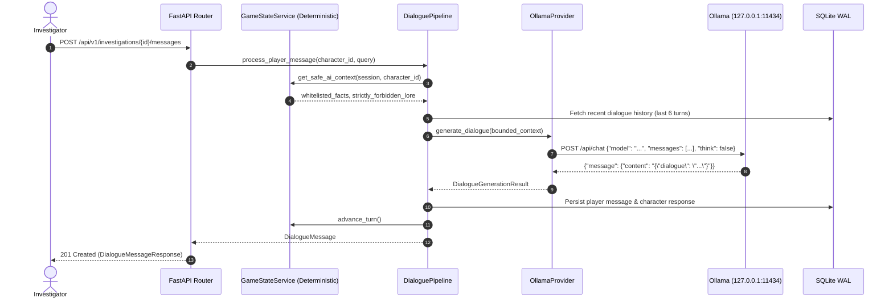

# Séance Studio — Local AI & Character Dialogue Operator Guide

**Version**: `1.0.0`  
**Provider**: Local Ollama Daemon (HTTP on Loopback `127.0.0.1:11434`)  
**Architecture Contract**: [`BaseAIProvider`](file:///c:/local_disc_D/Hackathan/week_4/backend/app/ai/interface.py)  
**Implementation**: [`OllamaProvider`](file:///c:/local_disc_D/Hackathan/week_4/backend/app/ai/ollama_provider.py)  
**Pipeline**: [`DialoguePipeline`](file:///c:/local_disc_D/Hackathan/week_4/backend/app/ai/dialogue_pipeline.py)

---

## 1. Architectural Principles: Zero Cloud & Authoritative Separation

*Séance Studio* is strictly **offline-first**.
- **No Cloud AI / Telemetry**: Never sends requests outside `127.0.0.1`. No OpenAI, Anthropic, or external inference dependencies.
- **No Automatic Model Downloads**: The application will **never** automatically pull or switch models without explicit human action.
- **No Fabricated Fallbacks**: If Ollama or the configured model is unavailable, the system produces a transparent, actionable error allowing retry. It never pretends an AI generated a response when it did not.
- **Authoritative Determinism**: The game engine is the sole source of truth for clues, unlocks, and endings. The LLM only generates atmospheric dialogue within strictly whitelisted boundaries.



---

## 2. Configuration (`.env`)

Configure the local model in `.env` in the repository root:

```ini
# Base URL for local Ollama daemon (must be loopback)
OLLAMA_BASE_URL="http://127.0.0.1:11434"

# Primary local text generation model (verified via ollama list)
OLLAMA_MODEL="qwen3:4b"

# Optional local vision-language model (verified via ollama list)
OLLAMA_VISION_MODEL="qwen3-vl:8b"

# Inference timeout in seconds
OLLAMA_TIMEOUT_SECONDS=120

# Ollama memory keep-alive duration
OLLAMA_KEEP_ALIVE="5m"

# Security: Never automatically pull models during launch or gameplay
ALLOW_MODEL_AUTO_DOWNLOAD=false

# Offline strict mode
OFFLINE_STRICT_MODE=true
```

---

## 3. Verifying Health & Readiness

The backend provides two diagnostic endpoints that clearly distinguish between backend availability, server reachability, model presence, and inference readiness.

### A. Core Health Check: `GET /api/v1/health`
```powershell
Invoke-RestMethod http://127.0.0.1:8000/api/v1/health
```
**Healthy Response (200 OK):**
```json
{
  "success": true,
  "data": {
    "status": "healthy",
    "database_connected": true,
    "ollama_connected": true,
    "configured_text_model": "qwen3:4b",
    "text_model_available": true,
    "vision_model": "qwen3-vl:8b",
    "vision_model_available": true,
    "message": "Local AI ready. Primary text model 'qwen3:4b' active. Vision model 'qwen3-vl:8b' available.",
    "offline_strict": true
  }
}
```

### B. Detailed AI Diagnostics: `GET /api/v1/ai/status`
```powershell
Invoke-RestMethod http://127.0.0.1:8000/api/v1/ai/status
```

| Field | Meaning |
|---|---|
| `status` | `healthy`, `ollama_unreachable`, `model_unconfigured`, `model_missing`, or `inference_failed`. |
| `backend_available` | True if FastAPI backend is healthy. |
| `ollama_connected` / `connected` | True if Ollama HTTP server at `127.0.0.1:11434` responded. |
| `configured_text_model` | Value of `OLLAMA_MODEL` in `.env`. |
| `text_model_available` | True if `configured_text_model` is present in Ollama's local tags. |
| `vision_model` | Value of `OLLAMA_VISION_MODEL` in `.env`. |
| `vision_model_available` | True if `vision_model` is present in Ollama's local tags. |
| `inference_ready` | True if ready to generate character dialogue immediately. |
| `available_models` | List of models currently installed locally in Ollama. |
| `latency_ms` | Round-trip latency in milliseconds. |
| `actionable_message` | Clear human-readable next steps if degraded. |

---

## 4. Running a Local Inference Test

You can verify character dialogue synthesis directly via the command line or pytest:

### A. Run Deterministic Test Suite (Unit & Error Integration)
Unit tests mock the provider and execute in milliseconds:
```powershell
powershell -ExecutionPolicy Bypass -File .\scripts\test-backend.ps1
```

### B. Run Live Ollama Smoke Test
When Ollama is running and `OLLAMA_MODEL` is installed, execute the live smoke test:
```powershell
.venv\Scripts\pytest backend/tests/test_ai_provider.py -k test_real_ollama_live_inference_smoke -v
```

### C. Manual API Message Test
Send an interrogation query to Caretaker Arthur Briggs:
```bash
# 1. Start investigation
curl -X POST http://127.0.0.1:8000/api/v1/investigations \
  -H "Content-Type: application/json" \
  -d '{"scenario_id": "case_blackwood_thirteenth_chime"}'

# 2. Interrogate character
curl -X POST http://127.0.0.1:8000/api/v1/investigations/<SESSION_ID>/messages \
  -H "Content-Type: application/json" \
  -d '{"character_id": "char_caretaker", "content": "What was that sound in the courtyard?"}'
```

---

## 5. Troubleshooting & Error Scenarios

The engine returns structured, actionable HTTP errors when AI inference fails:

### 1. `OLLAMA_UNREACHABLE` (HTTP 503 Service Unavailable)
- **Cause**: Ollama daemon is not running on port 11434.
- **Diagnostic**: `connected: false`, `error: "Connection refused at http://127.0.0.1:11434"`.
- **Fix**: Open the Ollama desktop app or run:
  ```powershell
  ollama serve
  ```

### 2. `MODEL_MISSING` (HTTP 503 Service Unavailable)
- **Cause**: Ollama is running, but the model configured in `OLLAMA_MODEL` is not downloaded.
- **Diagnostic**: `connected: true`, `model_available: false`.
- **Actionable Message**: `"Model 'xyz' is not installed. Run 'ollama run xyz' locally or update OLLAMA_MODEL in .env."`
- **Fix**: Check installed models:
  ```powershell
  ollama list
  ```
  Then set `OLLAMA_MODEL` in `.env` to an installed model, or install the model:
  ```powershell
  ollama pull qwen3:4b
  ```

### 3. `INFERENCE_TIMEOUT` (HTTP 504 Gateway Timeout)
- **Cause**: Model inference exceeded `OLLAMA_TIMEOUT_SECONDS` (e.g. cold-load into VRAM).
- **Diagnostic**: `status: 504`, `error: "timeout"`.
- **Fix**: Increase `OLLAMA_TIMEOUT_SECONDS=30` in `.env`, or retry the inquiry after the model has completed cold loading.

### 4. `INPUT_VALIDATION` (HTTP 400 Bad Request)
- **Cause**: Empty message or message exceeding 1,000 characters.
- **Fix**: Send a valid player query between 1 and 1,000 characters.

---

## 6. Prompt Injection & Anti-Spoiler Safeguards

Player input is strictly isolated:
1. **Delimitation**: Player text is enclosed in `<player_utterance>...</player_utterance>`.
2. **Tag Neutralization**: XML-like injection markers (`<system>`, `</player_utterance>`) are automatically stripped before prompt compilation.
3. **Redaction**: If the model output inadvertently contains an unrevealed clue ID (e.g. `clue_crypt_journal`), the output sanitizer redacts it to `[unsubstantiated rumor]`.
4. **Non-authoritative**: Any claim by the LLM that a clue was found or a room was unlocked is ignored by the engine; state changes occur strictly through deterministic action endpoints.
