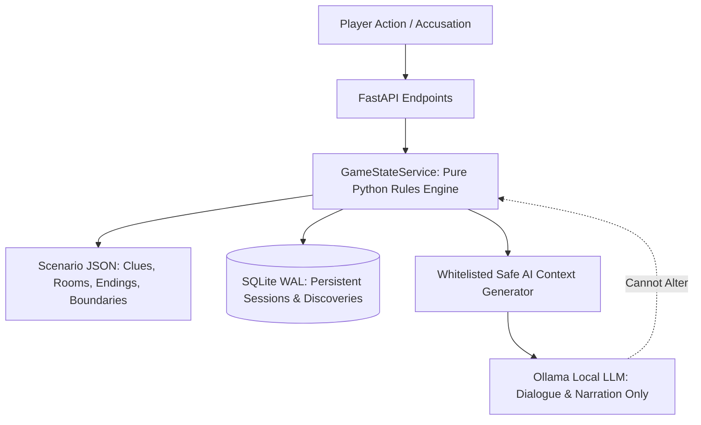

# Séance Studio — Scenario Definition & Authoring Schema

**Version**: `1.0.0`  
**Location**: `backend/content/scenarios/<scenario_id>.json`  
**Engine Implementation**: [`GameStateService`](file:///c:/local_disc_D/Hackathan/week_4/backend/app/engine/game_state_service.py)  
**Pydantic Contract**: [`ScenarioAsset`](file:///c:/local_disc_D/Hackathan/week_4/backend/app/schemas/scenario_schema.py)

---

## 1. Architectural Philosophy: The Deterministic Wall

In *Séance Studio*, the local Large Language Model (LLM) is strictly an **actor and atmospheric prose generator**. It is **never** the authority on game state.



### Inviolable Rules
1. **Clue Existence**: A clue exists if and only if it is defined in the scenario asset.
2. **Clue Discovery**: A clue can only be discovered if its prerequisites (unlocked room, parent clues, flags) are satisfied. Unknown IDs are rejected with validation errors.
3. **Room Unlocks**: Location transitions are computed strictly from player discoveries, decisions, and trust thresholds.
4. **Knowledge Boundaries**: The LLM context builder only passes facts that the character is explicitly permitted to know based on always-known facts and discovered clues. Undiscovered clues and forbidden lore are strictly redacted.
5. **Branching Endings**: An ending cannot be triggered by arbitrary LLM text or client input. The accusation matrix (Suspect + Weapon + Motive + Supporting Evidence) is evaluated deterministically against the scenario's ending rules.

---

## 2. Top-Level Scenario Structure

Every scenario definition is a single self-contained JSON document stored under `backend/content/scenarios/`.

```json
{
  "schema_version": "1.0.0",
  "id": "case_blackwood_thirteenth_chime",
  "title": "Blackwood Manor: The Thirteenth Chime",
  "subtitle": "A Victorian Occult Inquest",
  "era": "October 1922",
  "difficulty": "seasoned",
  "description": "Narrative overview of the inquest...",
  "max_turns": 30,
  "initial_objective": "Interview the Caretaker, commune with the spirit, and search the manor.",
  "starting_location_id": "room_foyer",
  "active_entity_id": "char_apparition",
  "characters": [ ... ],
  "clues": [ ... ],
  "locations": [ ... ],
  "permitted_connections": [ ... ],
  "endings": [ ... ]
}
```

---

## 3. Characters (`characters[]`)

Each character definition specifies emotional parameters, knowledge boundaries, and evidence presentation reactions.

| Field | Type | Description |
|---|---|---|
| `id` | `string` | Stable identifier (e.g., `char_caretaker`, `char_daughter`, `char_apparition`). |
| `name` | `string` | Display name (e.g., `"Arthur Briggs"`). |
| `role_type` | `string` | Role classification (`caretaker`, `daughter`, `apparition`, `detective`, etc.). |
| `entity_type` | `string` | Entity nature (`living`, `spirit`, `medium`). |
| `initial_trust` | `int` (0-100) | Starting trust score. |
| `min_trust` | `int` (0-100) | Minimum possible trust (clamped; cannot drop below). |
| `max_trust` | `int` (0-100) | Maximum possible trust (clamped; cannot exceed). |
| `knowledge_boundaries` | `object` | Explicit facts known, conditional facts, and strictly forbidden lore. |
| `presentation_triggers` | `map<clue_id, object>` | Deterministic reactions when presented with evidence. |
| `dialogue_topics` | `array<object>` | Inquiry topics with unlock conditions. |

### Knowledge Boundaries Schema
```json
"knowledge_boundaries": {
  "always_known_facts": [
    "The grandfather clock chimed thirteen times at midnight."
  ],
  "conditional_facts": {
    "clue_arsenic_vial": "The vial came from my potting bench; Julian was seen fleeing the terrace."
  },
  "strictly_forbidden_knowledge": [
    "The legal clauses of Eleanor's revised will."
  ]
}
```

### Evidence Presentation Triggers
When the player confronts a character with evidence, the engine executes the matching trigger:
```json
"presentation_triggers": {
  "clue_thirteenth_chime": {
    "trust_delta": 15,
    "response_dialogue": "Aye, that escapement gear has fresh file marks. Julian asked me how the assembly operated.",
    "emotional_cue": "Validated Realism",
    "atmospheric_cue": "Distant thunder rumbles across the grounds",
    "revealed_fact": "Julian asked Arthur about clock chime mechanics two days prior.",
    "unlocks_topic_id": "topic_clock_tampering",
    "sets_flags": { "caretaker_acknowledged_clock": true }
  }
}
```
*Note*: Evidence presentation is **idempotent**. Presenting the same clue multiple times will replay the dialogue but will **not** repeatedly increase or decrease trust.

---

## 4. Clues & Deductions (`clues[]`)

All evidence items must be declared with prerequisites and categories.

| Field | Type | Description |
|---|---|---|
| `id` | `string` | Stable identifier (e.g., `clue_silver_flask`). |
| `title` | `string` | Full evidence title. |
| `category` | `string` | `physical`, `testimony`, `document`, or `paranormal`. |
| `evidence_marker` | `string` | Marker tag (e.g., `"A-1"`, `"B-3"`). |
| `is_key_evidence` | `bool` | True if mandatory for high-tier victory endings. |
| `initially_revealed` | `bool` | True if discovered at the start of the inquest. |
| `prerequisites` | `object` | Requirements needed before the clue can be discovered. |

### Clue Prerequisites Schema
```json
"prerequisites": {
  "required_location_id": "room_cellar",
  "required_hotspot_id": "hs_barrel_rack",
  "required_clue_ids": ["clue_torn_velvet"],
  "required_flags": { "has_crypt_key": true }
}
```

---

## 5. Locations & Hotspots (`locations[]`)

Rooms represent the physical and spiritual spaces within the manor.

| Field | Type | Description |
|---|---|---|
| `id` | `string` | Stable identifier (e.g., `room_conservatory`). |
| `unlocked_by_default` | `bool` | `true` for starting rooms (`room_foyer`, `room_seance`). |
| `unlock_conditions` | `object` | Rules required to open locked rooms. |
| `hotspots` | `array<object>` | Interactive examination points within the room. |

### Location Unlock Conditions Schema
```json
"unlock_conditions": {
  "required_clue_ids": ["clue_silver_flask"],
  "min_character_trust": { "char_caretaker": 50 },
  "required_flags": { "has_crypt_key": true }
}
```

---

## 6. Permitted Deductive Connections (`permitted_connections[]`)

The Evidence Board allows players to link two clues. Links are validated against authoritative permitted connections:

```json
{
  "from_clue_id": "clue_silver_flask",
  "to_clue_id": "clue_arsenic_vial",
  "relationship": "weapon_match",
  "label": "Toxicological Match",
  "reason": "Chemical residue in the silver cordial flask matches the arsenic trioxide crystals in the conservatory vial."
}
```
*Valid Relationships*: `weapon_match`, `implicates`, `alibi_for`, `contradicts`.

---

## 7. Branching Endings (`endings[]`)

*Séance Studio* features three canonical endings evaluated through deterministic boolean logic:

| Ending ID | Verdict Type | Rating | Core Narrative Outcome |
|---|---|---|---|
| `END_TRUE_RESTITUTION` | `exemplary_victory` | Rank S | Julian apprehended by Scotland Yard; estate preserved; Eleanor's spirit rests. |
| `END_TRAGIC_COVERUP` | `hollow_victory` | Rank C | Julian escapes to Continent due to lack of crypt ledger / trust; estate ruined. |
| `END_SPECTRAL_WRATH` | `wrongful_conviction` | Rank F | Innocent suspect accused or player sanity reaches 0; spectral storm consumes manor. |

### Prerequisites Schema
```json
"prerequisites": {
  "required_suspect_id": "char_julian",
  "required_weapon_clue_id": "clue_silver_flask",
  "required_motive_clue_id": "clue_burned_will",
  "min_supporting_clues": 3,
  "required_supporting_clue_ids": [
    "clue_thirteenth_chime",
    "clue_arsenic_vial",
    "clue_crypt_journal"
  ],
  "min_player_sanity": 40,
  "min_character_trust": {
    "char_caretaker": 50,
    "char_daughter": 55
  }
}
```

---

## 8. Authoring a New Mystery: Checklist

To create a new case (e.g. `case_st_jude_asylum.json`):

1. **Create JSON Asset**: Create `backend/content/scenarios/<case_id>.json` following `ScenarioAsset` schema.
2. **Define Stable IDs**: Use consistent prefixes (`char_`, `clue_`, `room_`, `hs_`, `END_`).
3. **Verify Graph Connectivity**: Ensure every room, clue, and ending has at least one valid progression path from the starting state.
4. **Validate Schema**:
   ```bash
   python -c "from app.engine.game_state_service import GameStateService; GameStateService.load_scenario('<case_id>', reload=True)"
   ```
5. **Write Deterministic Playthrough Tests**: Add complete playthrough tests under `backend/tests/` demonstrating that all three endings are reachable.
